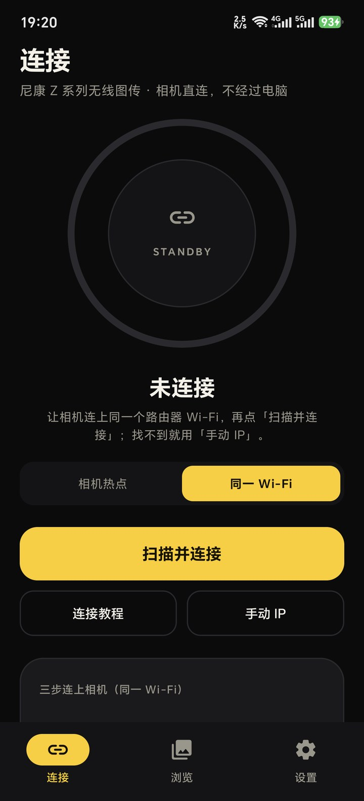
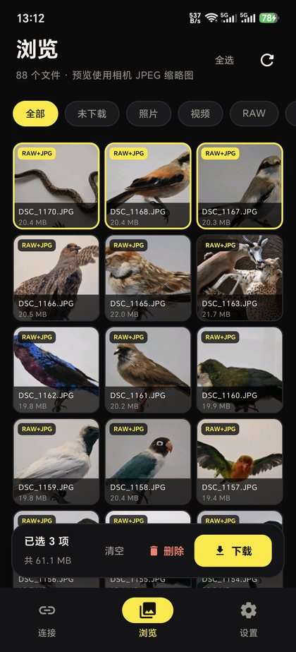

<h1>
  &nbsp;NikonLink
</h1>

**尼康 Z 系列相机 → Android 无线图传。** 手机直连相机 Wi-Fi，走原生 **PTP/IP** 协议取图，不经过电脑、不需要尼康官方 App，也不用数据线。

  
  
  

  
  
  
  

---

## 功能一览

| 模块 | 能力 |
|---|---|
| **连接** | 两种模式：**AP** 用 `WifiNetworkSpecifier` 加入相机热点（SSID / 密码可在弹窗里填），默认探测 `192.168.1.1:15740`；**STA** 扫描当前局域网（或手动 IP）直连相机 |
| **稳定** | 心跳可调（10/15/30/60 s）、掉线指数退避重连（1→30 s）、前台服务保活，锁屏不中断 |
| **教程** | 内置分步连接教程（Z50II / 其它 Z / D 系列菜单路径），连不上时的排查清单 |
| **浏览** | 按 handle 倒序分页读取存储卡，JPEG 缩略图懒加载 + 内存 LRU 缓存，按全部 / 照片 / 视频 / RAW 筛选 |
| **下载** | 分块 `GetPartialObject` 流式落盘，`.part` 断点文件，完成后校验大小并写入系统相册；传输条显示速度与剩余时间，结束后可「打开相册 / 重试失败项」 |
| **存储** | 图片进 `Pictures/NikonLink`，视频进 `Movies/NikonLink`（MediaStore，无需存储权限） |
| **自动拉取** | 监听相机 `ObjectAdded` 事件，拍摄即传；默认关闭，开启时不会把旧照片一起拉下来 |
| **相机标记** | 读取相机上「发送到智能设备」的标记队列（尼康 `0x9407/0x9408`），在「相机标记」筛选里一键全部下载 |
| **RAW 配对** | 选中 `DSC_0001.NEF` 时自动带上同名的 `DSC_0001.JPG`，预览与分享都有图；可在设置里关闭 |
| **未下载筛选** | 「未下载」只看还没取回的文件，配合「全选」可一键把新片搬空 |
| **诊断** | 一键复制相机型号 / 固件 / 连接地址 / 最近 150 条协议日志，方便反馈问题 |
| **应用内更新** | 「设置 → 关于」自动比对 GitHub Releases，有新版本时显示徽标；弹窗查看更新内容，App 内下载 APK 并拉起系统安装器（非静默，需允许安装未知应用） |
| **配对相机** | 「设置 → 连接 → 配对相机」按 SnapBridge 的同一套 PTP/IP 配对流程注册本机（进入配对模式 → 取配对码 → 完成配对）；配对后相机记住本机、保存网络，不必每次重走连接向导 |
| **遥控拍摄** | 连接后轻触连接页的圆环（整圈可点）进入遥控页：顶部显示挡位 / 光圈 / ISO / 快门，按快门拍到相机存储卡（尼康 `0x9207`），可选中自动换成大图预览；实时取景尚未实现 |

---

## 下载与安装

1. 到 [Releases](https://github.com/AchooLuv/NikonLink/releases/latest) 下载 `NikonLink-<版本>-arm64.apk`
2. 允许「安装未知来源应用」，安装后打开
3. 首次启动授予附近设备 / 位置权限（Android 连接指定 Wi-Fi 必需）
4. 相机开 Wi-Fi，手机连上同一网络，回到 App 点连接即可

> 装好之后不必再回网页：**设置 → 关于** 会在有新版本时提示，可直接在 App 内下载并安装。

**要求**：Android 10 (API 29) 及以上，arm64-v8a。APK 约 2.3 MB，不含任何广告或统计 SDK。

---

## 文档

| 文档 | 内容 |
|---|---|
| [使用指南](docs/USAGE.md) | 连接步骤（AP / STA）、机型支持、常见问题 |
| [技术实现](docs/PROTOCOL.md) | PTP/IP 细节、已验证的尼康指令表、构建与协议致谢 |

---

## 免责声明

非尼康官方产品，与尼康公司无关联。使用前请自行确认相机固件已开启 Wi-Fi 功能；因使用本工具造成的任何数据或设备问题由使用者自行承担。

## 关键词

尼康图传 · 尼康无线图传 App · Nikon 相机传照片到手机 · Z50II 图传 · 尼康相机 Wi-Fi 传图 · 尼康 STA 模式 · 相机接入路由器传图 · SnapBridge 替代 · PTP/IP Android 客户端 · NEF/RAW 下载 · 断点续传 · Kotlin Compose · Nikon wireless tethering · Nikon camera photo transfer · Z-series photo transfer
