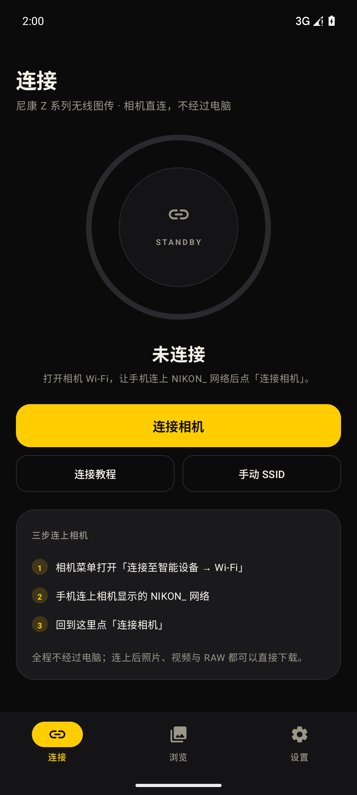
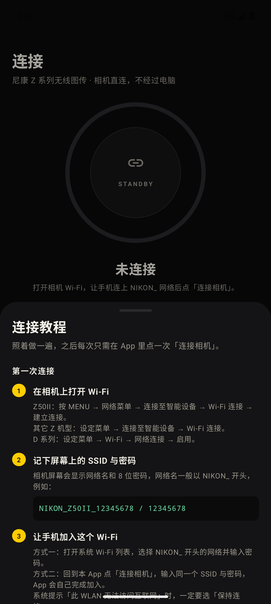
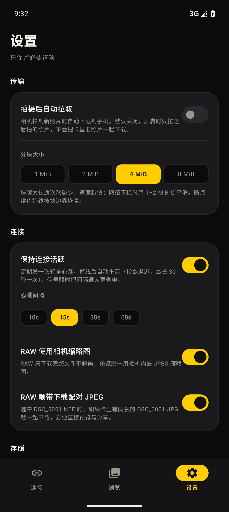
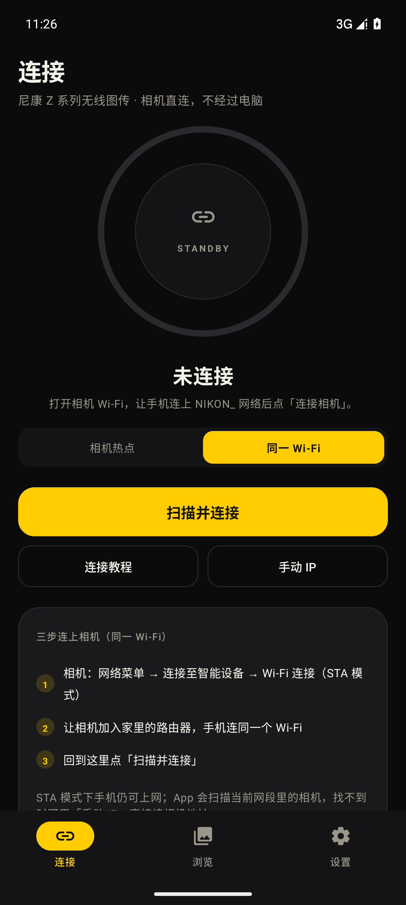

# NikonLink

<p align="center">
  
</p>

**尼康 Z 系列相机 → Android 无线图传。** 手机直连相机 Wi-Fi，走原生 **PTP/IP** 协议取图，不经过电脑、不需要尼康官方 App，也不用数据线。

[](https://github.com/AchooLuv/NikonLink/releases/latest)
[](#下载与安装)
[](#技术实现)

<p align="center">
  
  
  
</p>

## 它解决什么

SnapBridge 传图慢、后台易断、RAW 体验差，第三方方案大多要电脑。NikonLink 只做一件事：**把相机的照片、视频和 RAW 稳定地搬到手机里**，顺便把连接这一步做到尽量少点几下。

- 🎯 目标机型：**Nikon Z50II（Z 系列）**；共用 PTP/IP 的尼康 Wi-Fi 机型（Z50 / Z6 / Z7 / D5300 / D5600 / D750 / D850 等）同样适用
- 🔗 两种连接方式：**相机热点（AP）** 直接连相机；**同一 Wi-Fi（STA）** 让相机加入路由器，手机在同一网络里连它，还能正常上网
- 📱 手机端只需连接、浏览、设置三个页面
- 🖼️ JPEG 直接预览；**RAW（NEF）原样完整下载**，App 内不解码，预览统一用相机内嵌 JPEG 缩略图
- 📦 视频、RAW 大文件走 **4 MiB 分块 + 流式写盘**，内存占用恒定，不会 OOM
- ⏯️ **断点续传**：中断后重新下载，从已写入的字节继续
- 📸 **拍摄后自动拉取**（默认关闭），开启后相机新拍的照片会自动落到手机

## 功能一览

| | |
|---|---|
| 连接 | 两种模式：**AP** 一键加入相机热点（`WifiNetworkSpecifier`）+ 自动探测 `192.168.1.1:15740`；**STA** 扫描当前局域网（或手动 IP）直连相机 |
| 稳定 | 心跳可调（10/15/30/60 s）、掉线指数退避重连（1→30 s）、前台服务保活，锁屏不中断 |
| 教程 | 内置分步连接教程（Z50II / 其它 Z / D 系列菜单路径），连不上时的排查清单 |
| 浏览 | 按 handle 倒序分页读取存储卡，JPEG 缩略图懒加载 + 内存 LRU 缓存，按全部 / 照片 / 视频 / RAW 筛选 |
| 下载 | 分块 `GetPartialObject` 流式落盘，`.part` 断点文件，完成后校验大小并写入系统相册；传输条显示速度与剩余时间，结束后可「打开相册 / 重试失败项」 |
| 存储 | 图片进 `Pictures/NikonLink`，视频进 `Movies/NikonLink`（MediaStore，无需存储权限） |
| 自动拉取 | 监听相机 `ObjectAdded` 事件，拍摄即传；默认关闭，开启时不会把旧照片一起拉下来 |
| 相机标记 | 读取相机上「发送到智能设备」的标记队列（尼康 `0x9407/0x9408`），在「相机标记」筛选里一键全部下载 |
| RAW 配对 | 选中 `DSC_0001.NEF` 时自动带上同名的 `DSC_0001.JPG`，预览与分享都有图；可在设置里关闭 |
| 未下载筛选 | 「未下载」只看还没取回的文件，配合「全选」可一键把新片搬空 |
| 诊断 | 一键复制相机型号 / 固件 / 连接地址 / 最近 150 条协议日志，方便反馈问题 |

## 下载与安装

1. 到 [Releases](https://github.com/AchooLuv/NikonLink/releases/latest) 下载 `NikonLink-<版本>-arm64.apk`
2. 允许「安装未知来源应用」，安装后打开
3. 首次启动授予附近设备 / 位置权限（Android 连接指定 Wi-Fi 必需）

要求：**Android 10 (API 29) 及以上，arm64-v8a**。APK 约 2 MB，不含任何广告或统计 SDK。

## 连接步骤

连接页顶部可以在两种模式间切换，选一次就会记住。

### 相机热点（AP 模式）

1. **相机**：`MENU → 网络菜单 → 连接至智能设备 → Wi-Fi 连接 → 建立连接`（其它 Z 机型在「设定菜单」，D 系列在「设定菜单 → Wi-Fi」）
2. 记下相机屏幕上的 `NIKON_...` 网络名和 8 位密码
3. **手机**：系统 Wi-Fi 里连上该网络（提示「无法访问互联网」时选**保持连接**），或回到 App 点「连接相机」输入 SSID/密码由 App 代连
4. **App**：点「连接相机」，看到型号与电量即成功；随后在「浏览」里选文件下载

### 同一 Wi-Fi（STA 模式）

1. **相机**：`网络菜单 → 连接至智能设备 → Wi-Fi 连接（STA 模式）→ 建立配置`
2. 给配置起名 → 选择家里的路由器 SSID → 输入 Wi-Fi 密码 → IP 选「自动获取」
3. **手机**：连同一个路由器 Wi-Fi（不用连相机热点，手机仍可上网）
4. **App**：模式切到「同一 Wi-Fi」→ 点「扫描并连接」；找不到就用「手动 IP」填相机在局域网里的地址

<p align="center">
  
</p>

> 同一时间只能有一个客户端连相机：请先完全退出 SnapBridge。

## 机型支持

| 模式 | 原理 | 支持的机型 |
|---|---|---|
| **AP**（相机热点） | 相机自己开热点，手机连上去，不依赖路由器 | 带 Wi-Fi 的 Z 系列（Z50 / Z50II / Z6 II / Z6 III / Z7 / Z7 II / Z8 / Z9 / Zf 等）以及 D 系列 Wi-Fi 机型 |
| **STA**（同一 Wi-Fi） | 相机加入现有路由器或手机热点，手机在同一网络里通过局域网连它 | 菜单里出现「Wi-Fi 连接（STA 模式）」的机型，如 Z9（C 固件 5.00 起）、Z8、Z50II 等较新机型 |

> 判断方法：相机菜单里能选到「Wi-Fi 连接（STA 模式）」就支持 STA；只有「Wi-Fi 连接」一项时用 AP 模式即可。两种模式共用同一套 PTP/IP 传输，功能没有差别。

## 常见问题

**连不上 / InitFail** — 相机被其它设备占用，关掉 SnapBridge 后重开相机 Wi-Fi。

**相机不在 192.168.1.x 网段** — 「手动 SSID」里把相机 IP 填上（例如 `192.168.0.1`），App 会直接连这个地址。

**STA 模式扫不到相机** — 多半是路由器开了「AP 隔离 / 客户端隔离」；确认相机和手机在同一个 SSID、同一网段，并临时关掉 VPN / 代理后重试，或者直接用「手动 IP」。

**传输中自动断开** — 关闭手机「WLAN+ / 智能网络切换」，它会把没有互联网的相机网络切走。

**相机一会儿就断** — 设定菜单里把「自动关机时间」调长；半按快门可唤醒。

**RAW 没有缩略图** — 部分机型不对 NEF 返回缩略图，格子里会显示 `RAW` 占位，不影响完整下载。

**下载一半失败** — 直接重试同一个文件，会从 `.part` 的断点继续。

**连不上、想反馈** — 设置页 →「复制诊断信息」，把复制到的内容贴到 [Issues](https://github.com/AchooLuv/NikonLink/issues)，里面已包含相机型号、固件与最近的协议日志。

## 技术实现

- **PTP/IP（ISO 15740 over TCP，端口 15740）**：双 TCP 连接（命令/数据 + 事件），`Init_Command_Request/Ack`、`Init_Event_Request/Ack` 握手，`OpenSession` 后执行 PTP 事务
- 用到的操作：`GetDeviceInfo`、`GetStorageIDs`、`GetObjectHandles`、`GetObjectInfo`、`GetThumb`、`GetPartialObject`，以及尼康厂商操作 `0x90C4`（大缩略图）、`0x9407/0x9408`（「发送到智能设备」队列）
- **流式传输**：按 PTP 包长度从 socket 直接读入 256 KiB 缓冲并写入 `RandomAccessFile`，单文件内存占用与文件大小无关
- **STA 发现**：枚举手机自己的 IPv4 网段，48 路并发探测 `15740` 端口，失败可手动指定 IP；AP 模式则用 `WifiNetworkSpecifier` 加入相机热点
- **断点续传**：`.part` 文件 + `GetPartialObject(handle, offset, 4 MiB)`，恢复时按 `.part` 长度定位
- **稳定性**：`TCP_NODELAY`、4 MiB 接收缓冲、15 s 心跳、事件线程监测断链、指数退避重连、前台服务保活
- **UI**：Jetpack Compose + Material 3，尼康黄（`#FFCD00`）单一强调色，深色底；R8 收缩后整包约 2 MB

## 构建

```bash
# JDK 17 + Android SDK 35
./gradlew :app:assembleRelease      # 产物：app/build/outputs/apk/release/app-release.apk
./gradlew :app:testDebugUnitTest    # 30 项测试，含进程内假相机的 PTP/IP 回环测试
```

`keystore/nikonlink-release.jks` 为发布签名（口令写在 `app/build.gradle.kts`），用于让后续版本可以覆盖安装。

## 更新日志

**v0.1.16**
- 修复 STA 扫描不到相机（手动 IP 却可以）：网段改为从 `LinkProperties` 取（Android 16 上枚举网卡可能拿不到地址），并把探测超时放宽到 650 ms
- STA 连接会先试「上次成功的相机 IP」，命中就跳过扫描；诊断日志新增「扫描网段 / 扫描结果」
- 连接中、重连中都可手动停止：主按钮变成「取消连接 / 停止重连」，不必再杀进程
- 教程与连接页共用同一份模式设置，选「同一 Wi-Fi」后打开教程直接就是 STA
- 界面术语统一为「相机热点 / 同一 Wi-Fi」，AP / STA 只保留在文档里

**v0.1.15**
- 新增 **Wi-Fi STA 模式**：相机加入现有路由器（或手机热点），手机在同一网络里扫描 15740 端口直连，找不到可手动填 IP
- 连接页顶部加了两段式模式开关（相机热点 / 同一 Wi-Fi），切换后按钮、提示与教程都跟着变，不新增底部菜单
- 连接教程改为全屏页面：标题固定不滚动，内容不会再穿透状态栏；教程内含 AP / STA 两套步骤
- README 增加「机型支持（AP / STA）」章节与 STA 排查项，关键词补充「尼康图传 / 尼康 STA 模式」

**v0.1.14**
- 「连接」和「设置」页的顶栏固定，不再随内容滚动，与「浏览」页一致

**v0.1.13**
- 中文系统桌面名称显示「尼康图传」，英文系统仍为 `NikonLink`

**v0.1.12**
- 图标换成带 NikonLink 字标的插画版：相机 → Wi-Fi → 照片卡片 → 手机，整体缩放进自适应图标安全区，圆形遮罩下相机、手机与字标都完整
- README 顶部加上同一张品牌图
- 三个页面的标题更贴近状态栏（顶部留白 28/24dp → 6dp），不再是「标题离状态栏一大截空白」
- 启动闪屏背景改为深色（`windowSplashScreenBackground`），去掉进入 App 时的白闪

**v0.1.11**
- 图标第二版：黑色相机 + 黄色镜头 + 镜头内的向下传输箭头，去掉上一版像天线的信号弧，构图更居中；48dp 下仍能看出「从相机取图」的意思

**v0.1.10**
- 设置页「分块大小」改为四等宽分段控件，任何屏宽/字号下都不换行
- 全新应用图标：尼康黄底 + 相机剪影 + 无线信号弧，图标内容收在自适应图标安全区内，圆形/方形遮罩都不会裁掉轮廓

**v0.1.9**（真机反馈修复）
- **修复断开后无法再次连接**：旧连接的 socket 工厂仍绑定在已释放的 Wi-Fi Network 上，导致之后每次拨号都走死路；现在每次连接都重置为默认路由，并抑制关闭旧连接时触发的重连竞争
- 设置页新增「重置连接与全部记录」：清空 SSID/密码、偏好、已下载记录与断点文件（不删相册里已下载的照片）
- 连接后显示**镜头型号、光圈/焦距、快门数**：读取最新一张照片的前 256 KiB 解析 EXIF（含 Nikon MakerNote 的 ShutterCount），不下载整张 RAW；重连后刷新
- **图库滚动优化**：缩略图的 PTP 网络 I/O 从主线程移到 IO 线程；传输进度改为独立订阅，滚动时不再因每块进度更新而整页重组
- 设置页分块大小改为流式布局，窄屏上 8 MiB 不再被挤断行
- 测试总数 36（新增 EXIF 解析 6 项）

**v0.1.8**
- 质量收尾：`lint` 从 2 error / 4 warning 降到 **0 error / 3 warning**（剩余为依赖版本、ChromeOS ABI、v26 资源目录提示）
- 修复：Android 12+ 精确位置权限必须同时声明 `ACCESS_COARSE_LOCATION`
- 修复：连接页在 composition 中读取 `StateFlow.value`，改为 `collectAsStateWithLifecycle`
- 修复：「RAW 使用相机缩略图」开关此前只存不改行为，现在关闭后 RAW 不再请求缩略图
- 清理无用代码（`Tag`、`TutorialButton`、`TutorialLinkRow`、若干未用工具函数与冗余 SDK 判断）

**v0.1.7**
- 断线重连会重新申请相机 Wi-Fi：手机漂回蜂窝网络后不再永远连不上
- 重连前先探测相机端口，不可达就立刻进入下一次退避，不再每次空等 12 秒超时
- 重连成功后自动重新解析相机地址并刷新相册；传输完成也会刷新存储余量
- 新增退避策略单测，测试总数 30

**v0.1.6**
- RAW 配对下载：选中 NEF 时自动带上同名 JPEG（设置里可关）
- 新增「未下载」筛选，配合「全选」可一键取回新片
- 相册重名自动加序号（`DSC_0001 (1).JPG`），清空下载记录后重复取回也不会覆盖或重名
- 新增配对与重名处理单测 8 项，测试总数 27

**v0.1.5**
- 连接成功后显示存储卡剩余 / 总容量（`GetStorageInfo` 汇总各卡）
- 传输期间自动保持屏幕常亮，批次结束立即释放
- 浏览页新增「全选」，一键选中当前筛选下的全部文件
- 新增 PTP/IP **回环测试**：用真实 socket 起一个假相机，覆盖握手、双通道、分块下载、断点续传、事件通道降级与 InitFail，共 4 项；测试总数 19

**v0.1.4**
- 传输条新增剩余时间（ETA）与实时速度；结束后出现结果条：打开相册 / 重试失败项 / 关闭
- 失败文件可一键重试，只重跑失败项，已成功的不会重复下载
- 心跳间隔可调（10 / 15 / 30 / 60 秒），弱信号或省电场景可放宽
- 新增格式化单元测试（大小 / 速度 / ETA），测试总数 15

**v0.1.3**
- 新增「相机标记」筛选：读取机身上标记的「发送到智能设备」队列，可全选下载（尼康厂商操作 0x9407/0x9408）
- 「手动 SSID」对话框支持填写相机 IP，应对相机不在 `192.168.1.x` 网段的情况
- 连接失败时给出可操作的中文提示，并提供「换 IP 重试 / 复制诊断信息」两个入口，不再直接抛英文 socket 文本

**v0.1.2**
- 分块被相机拒绝时自动降级（4 MiB → 2 MiB → 1 MiB → 512 KiB），并回滚该块已写入的半截数据，不会污染 `.part`
- 事件通道容错：相机不接受 PTP/IP 事件连接时仍可正常浏览与下载，设置页会标注「自动拉取不可用」
- 新增「复制诊断信息」：一键导出相机型号 / 固件 / 连接步骤 / 最近 150 条协议日志，便于定位连接问题

**v0.1.1**
- 缩略图改为 32 MB 有界缓存，几千张的卡滚动浏览也不会累积内存
- 自动拉取改用 handle 基线：开启后只拉之后拍的照片；换卡或格式化会自动校正
- 传输支持真正取消：当前分块结束即停，已下载部分保留为断点
- 连接时把 Wi-Fi 的 DHCP 网关也作为候选地址，非常规网段同样能自动找到相机
- 下载完成后的「已下载」标记立即刷新
- 新增 PTP/IP 协议单元测试（8 项，覆盖帧格式、握手编码、数据集解析）

**v0.1.0** — 首个公开版本：连接 / 浏览 / 设置三页，PTP/IP 直连，分块下载与断点续传。

## 协议致谢

PTP/IP 传输与尼康厂商操作的细节参考了开源项目 [AeroShutter](https://github.com/subhashraveendran/aero-shutter)（MIT），本项目以自己的 Kotlin 实现重写。PTP 基础协议见 ISO 15740。

## 免责声明

非尼康官方产品，与尼康公司无关联。使用前请自行确认相机固件已开启 Wi-Fi 功能；因使用本工具造成的任何数据或设备问题由使用者自行承担。

## 关键词

尼康图传 · 尼康无线图传 App · Nikon 相机传照片到手机 · Z50II 图传 · 尼康相机 Wi-Fi 传图 · 尼康 STA 模式 · 相机接入路由器传图 · SnapBridge 替代 · PTP/IP Android 客户端 · NEF/RAW 下载 · 断点续传 · Kotlin Compose · Nikon wireless tethering · Nikon camera photo transfer · Z-series photo transfer
