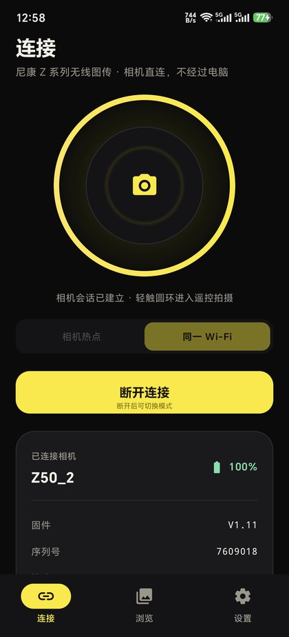
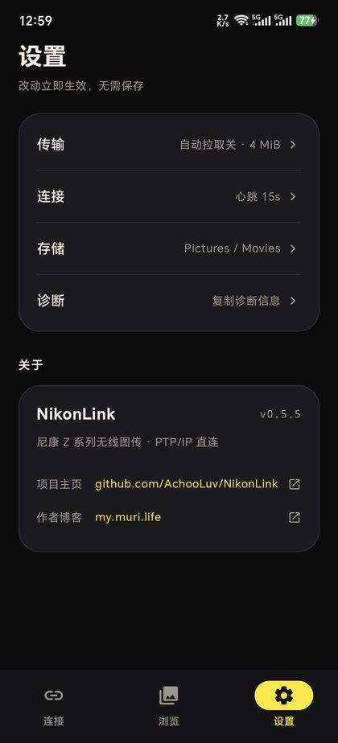

<h1>
  &nbsp;NikonLink
</h1>

**尼康 Z 系列相机 → Android 无线图传与遥控 App。** 手机连上相机 Wi-Fi，就能浏览、下载相机里的照片 / RAW / 视频，实时取景、点屏幕对焦、遥控快门与间隔拍摄；不用电脑、不用尼康官方 App、不用数据线。

支持 **相机热点（AP）** 与 **同一 Wi-Fi（STA）** 两种连法，适用于 Z50II、Z8、Z9、Z6III、Z5II、Zf、Z30 等 Z 系列机型；也可以当作 SnapBridge 的替代方案，把尼康相机照片无线传到手机。

  
  
  

  
  
  
  

---

## 功能一览

  <a href="#连接页">连接</a> ·
  <a href="#浏览页">浏览</a> ·
  <a href="#遥控拍摄页">遥控拍摄</a> ·
  <a href="#设置页">设置</a>

### 连接页

| 功能 | 说明 |
|---|---|
| 两种模式 | 连相机热点，或让相机加入家里的路由器（同一 Wi-Fi）；选一次即记住 |
| 自动发现 | 同一 Wi-Fi 下自动找到相机；扫不到可手动填相机地址 |
| 稳定连接 | 心跳间隔可调、掉线自动重连、锁屏后后台保持连接 |
| 连接信息 | 显示机型、固件、序列号、电量、镜头与存储剩余 |
| 连接教程 | 内置 Z50II / 其它 Z / D 系列的分步菜单路径与排查清单 |
| 进入遥控 | 轻触圆环（整圈可点）进入遥控拍摄页 |

### 浏览页

| 功能 | 说明 |
|---|---|
| 列表 | 按拍摄顺序倒序浏览存储卡，缩略图随滚动懒加载 |
| 筛选 | 全部 / 未下载 / 照片 / 视频 / RAW / 相机标记 |
| 下载 | 加入后台传输队列，按批次显示「已传 / 总数」；断点续传，完成后自动存入系统相册 |
| 传输状态 | 显示速度与剩余时间，结束后可打开相册或重试失败项 |
| 存储位置 | 图片存 `Pictures/NikonLink`，视频存 `Movies/NikonLink` |
| 自动拉取 | 相机拍一张就自动传一张；默认关闭，开启时不会补拉旧照片 |
| 相机标记 | 读取相机里「发送到智能设备」的标记项，一键批量下载 |
| RAW 配对 | 下载 NEF 时自动带上同名 JPG，可在设置里关闭 |
| 打开文件 | 图片与视频统一下载后在右下角出现小图标（眼睛 / 播放），点击用系统查看器或播放器打开 |
| 未下载筛选 | 只看还没取回的文件，配合「全选」一键搬空新片 |

### 遥控拍摄页

| 功能 | 说明 |
|---|---|
| 实时取景 | XGA / VGA 实时画面，链路慢时自动降画质；按快门时暂停、拍完恢复 |
| 取景信息 | 参数叠在画面上：左上挡位，底部光圈 / ISO / 快门 / 曝光补偿 / 焦段 |
| 工具开关 | 标题栏齿轮打开「工具」，默认全部关闭；打开哪项才显示对应图标，只控制显隐、不改变已设的值 |
| 参数控制 | 光圈、ISO、挡位、曝光补偿、白平衡、驱动模式用刻度尺调整；只读项置灰，机身拨盘改动自动同步 |
| 对焦 | 右侧 `AF` 圆形按钮单次对焦；或直接点画面任意位置，出现黄色焦点框并对焦 |
| 取景辅助 | 工具里开关网格线、峰值对焦；画质档位 流畅 / 标准 / 高画质 也在「工具」里 |
| 延迟拍摄 | 关闭 / 3 / 5 / 10 秒，倒计时结束才释放快门 |
| 间隔拍摄 | 间隔 1–60 秒、张数 5–50 或不限，显示进度，可随时停止；离开页面会自动停 |
| 快门 | 点一下拍一张；驱动模式为连拍时**按住快门**连续拍，松手即停；长曝光降噪期间不会重复下发 |
| 拍后回看 | 拍摄完成自动取回新照片，用于预览与「已下载」判断 |
| 机型支持 | 内置尼康官方支持 / 不支持实时取景的机型列表 |

### 设置页

| 功能 | 说明 |
|---|---|
| 传输 | 拍摄后自动拉取开关、分块大小（1 / 2 / 4 / 8 MiB） |
| 连接 | 心跳间隔；「配对相机」让相机记住本机，之后免重复连接 |
| 存储 | 保存位置说明、清除下载记录 |
| 诊断 | 一键复制机型 / 固件 / 地址 / 最近协议日志，便于反馈问题 |
| 关于 | 版本信息、项目主页、作者博客；检查更新并在 App 内下载安装 |

---

## 下载与安装

1. 到 [Releases](https://github.com/AchooLuv/NikonLink/releases/latest) 下载 `NikonLink-<版本>-arm64.apk`
2. 允许「安装未知来源应用」，安装后打开
3. 首次启动授予附近设备 / 位置权限（Android 连接指定 Wi-Fi 必需）
4. 相机开 Wi-Fi，手机连上同一网络，回到 App 点连接即可

> 装好之后不必再回网页：**设置 → 关于** 会在有新版本时提示，可直接在 App 内下载并安装。

**要求**：Android 10 (API 29) 及以上，arm64-v8a。APK 约 2.5 MB，不含任何广告或统计 SDK。

---

## 文档

| 文档 | 内容 |
|---|---|
| [使用指南](docs/USAGE.md) | 连接步骤、遥控拍摄、机型支持、常见问题 |
| [技术实现](docs/PROTOCOL.md) | PTP/IP 细节、已验证的尼康指令表、构建与协议致谢 |

---

## 关键词

尼康图传 · 尼康无线图传 App · Nikon 相机传照片到手机 · Z50II 图传 · 尼康相机 Wi-Fi 传图 · 尼康 STA 模式 · 相机接入路由器传图 · SnapBridge 替代 · PTP/IP Android 客户端 · NEF/RAW 下载 · 断点续传 · Kotlin Compose · Nikon wireless tethering · Nikon camera photo transfer · Z-series photo transfer
